## Tech Stack

### Strong

### Knowledgeable

## Contact

## About Me

LLM을 서비스에 붙이는 AI 백엔드를 만듭니다.

- FastAPI와 LangGraph로 생성·검증 파이프라인을 설계하고, Qdrant 하이브리드 검색으로 RAG를 구성합니다.
- vLLM으로 모델을 서빙하고, 작은 모델은 LoRA SFT로 학습한 뒤 양자화해 CPU에서 돌립니다.
- Apple Silicon에서 로컬 모델을 돌리고 성능을 재는 도구도 만듭니다.

## Core Projects

| 프로젝트 | 소개 | 스택 |
|:--|:--|:--|
| [**일과 (SW-ilgwa)**](https://github.com/algocean1204/SW-ilgwa) | 전공 PDF로 강의, 음성 수업, 모의고사를 만드는 AI 과외 플랫폼 · [서비스](https://algocean1204.github.io/SW-ilgwa/) | `FastAPI` `LangGraph` `vLLM` `Qdrant` |
| [**내 친구 민수 (emotion-healer)**](https://github.com/algocean1204/emotion-healer) | 앞 대화와 기억을 읽고 공감할지, 방법을 찾을지 정해 답하는 AI 친구 | `LangGraph` `FastAPI` `Neo4j` `PostgreSQL` |
| [**AlgoceanCodexOAuth**](https://github.com/algocean1204/AlgoceanCodexOAuth) | LangChain/LangGraph용 ChatOpenAI 대체 래퍼 (Codex OAuth, API key) · [PyPI](https://pypi.org/project/algocean-codex-oauth/) | `Python` `LangChain` `LangGraph` |
| [**AI Dashboard**](https://github.com/algocean1204/mlx-benchmark-dashboard) | Apple Silicon에서 로컬 모델의 TPS, TTFT, RAM을 실측해 비교하는 데스크탑 앱 | `Rust` `Flutter` `MLX` |
| [**Mac OCR APP**](https://github.com/algocean1204/Mac_OCR_APP) | 로컬 모델(GLM-OCR + LLM 3개)로 스캔 PDF를 검색 가능한 PDF로 바꾸고 권 단위로 나누는 macOS 앱 | `Python` `Flutter` `MLX` |
| [**FastOCR (Mac OCR APP Light)**](https://github.com/algocean1204/Mac_OCR_APP_light) | AI 모델 없이 Apple Vision으로 OCR하고 PDF 분할, 합치기, 추출을 하는 경량판 | `Flutter` `Apple Vision` `PyMuPDF` |
| [**LLM From Scratch & Fine-Tuning**](https://github.com/algocean1204/LLM-From-Scratch-and-FineTuning) | PyTorch로 GPT를 직접 구현해 사전학습하고 Kanana Nano 2.1B를 미세조정한 실습 | `PyTorch` `Transformers` |
| [**Vocab Master (WordList_web)**](https://github.com/algocean1204/WordList_web) | TOEIC, TEPS 단어 7,180개로 카드 학습과 4지선다 테스트를 하는 웹 앱 · [서비스](https://algocean1204.github.io/WordList_web/) | `Flutter` `Hive` |

